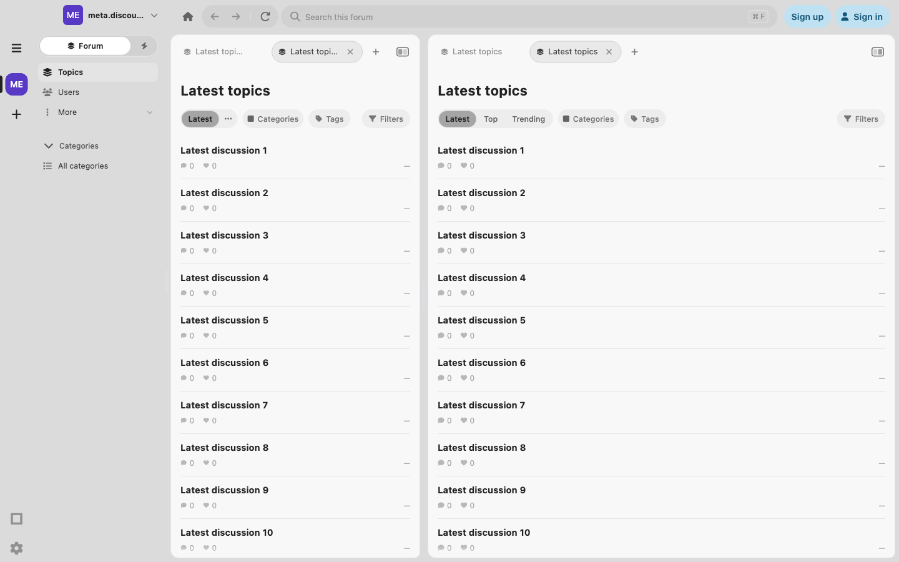
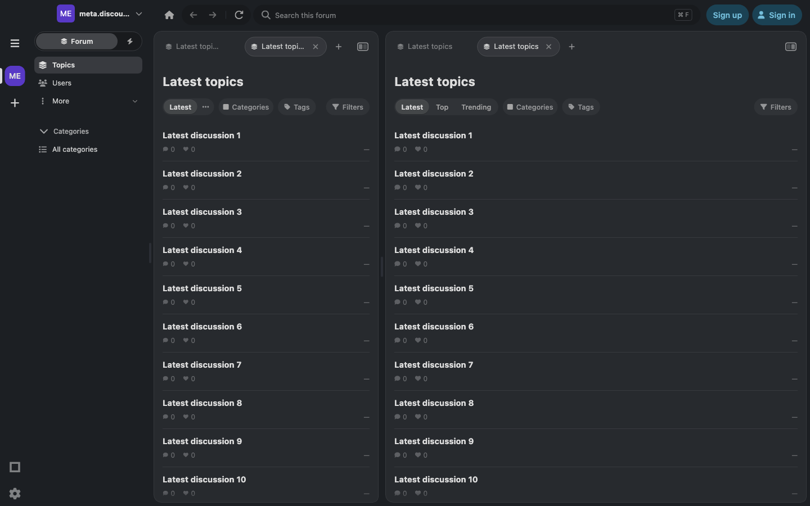
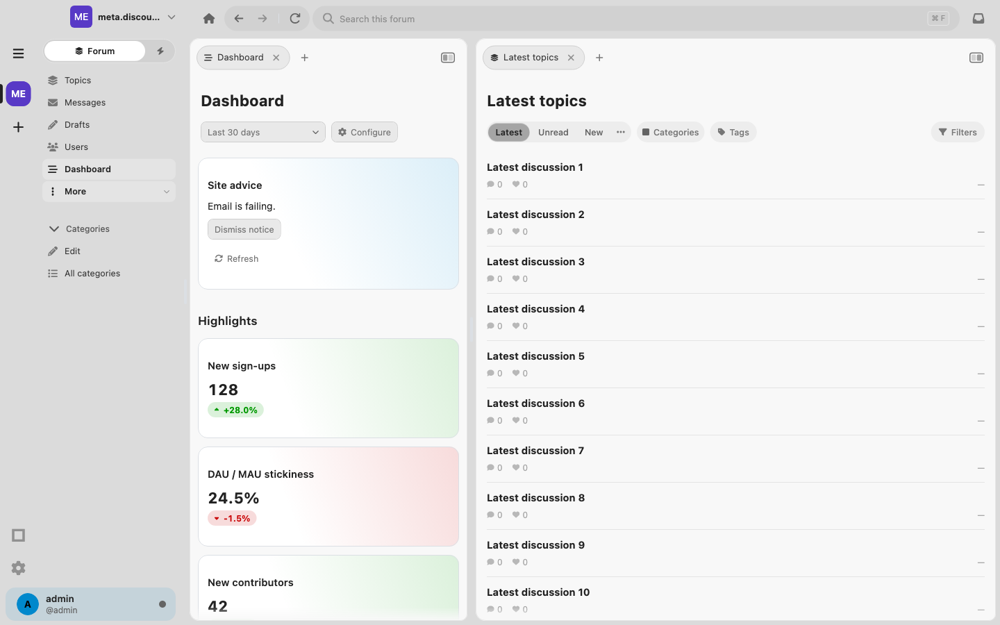
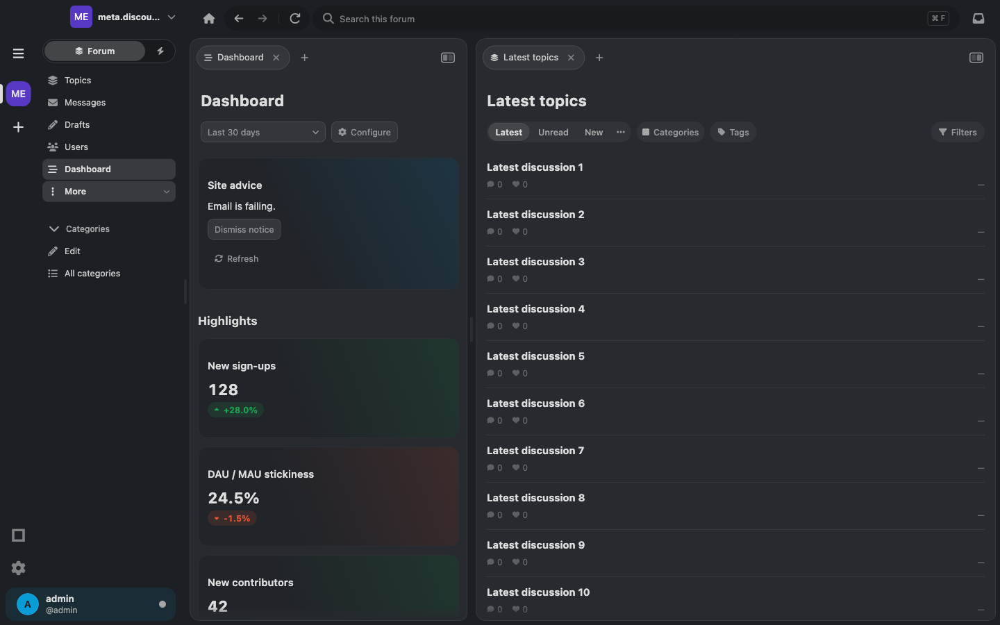

# Latest default and removal of Start

Design source: `discourse-native-mockups` commit
`7f43e9ddf474dd58225b6e30921c798ac641f202` (2026-11-03), exact
`src/App.tsx` and `src/app.css` diff against its parent. This document covers
Group 1. Chat sidebar search, chat pill spacing, and global search filter folding
belong to the following groups.

## Parity checklist

All source references below name the **new** line numbers in the design commit;
removed blocks are identified by the adjacent hunk location.

| Done | Design evidence | Native implementation | Verification |
| --- | --- | --- | --- |
| Yes | `App.tsx` 2510: Start leaves `PHONE_NAV`; 26183–26398: no Home-specific dock selection or empty footer | Delete `CorePage.start`, `ContentRoute.newTab`, `isNewTab`, and `NewTabPage`. New tabs have a regular Latest feed contract: Topics sidebar selection, filters, search scope, refresh, creation, and footer behavior. | New-tab controls test; Latest startup/pane test; mobile dock tests. |
| Yes | Existing `blankTab`, `addHomeTab`, `newSideTab`, and initial `listTabs`/`sideTabs` now render a topic list; 28449 and 28545: no house glyph or Start tab title | Initial workspaces, newly created tabs, replacement tabs after closing/moving the last tab, and empty secondary panes use `ContentRoute.topicList(TopicListMode.latest)`. Latest's page/tab title is “Latest topics” with the topic-list glyph. Startup, direct forum-root decoding and AI’s Browse forum fallback use the canonical `ContentRoute.homepage()` Latest route even if the server suggests Categories, Chat, or AI conversations. | Startup with Categories configured; shell tab lifecycle, drag, restart, Chat and AI navigation tests. |
| Yes | `goLatest`, 23498–23532: reuse/reset the primary home tab; scroll at Latest; call `slideView` only on phones | Desktop Home resets the primary home tab (its saved identity survives tab reordering) to unfiltered Latest and focuses it without creating another tab. Reselecting it invokes the primary page's existing Native `DPageHeader.scrollToTop`. `DesktopHomeHeaderHost` composes the existing kit host; secondary content cannot publish its header to that host. Phone Home retains its own navigation. | Home identity/filter reset and actual scroll-position test; side tab remains identical. Desktop history/button tests on macOS, Windows and Linux; phone transition tests. |
| Yes | 23605 and 24754–24788: remove `homeQuery`, `homeDense`, `askHome`, and cross-site session entries | Delete `ShellSearchController`'s Start query map, setters, getters, retention and account cleanup. Ordinary list/page queries and user-directory queries remain. No Start query state is persisted. | Search-controller tab/account ownership tests and topic-highlight lifecycle tests. |
| Yes | 28485–28516: remove `homeShowing`, `sideHomeShowing`, `searchPane`; Latest is an ordinary `searchOnList` | Latest uses the existing list expression, words, conditions, scope and source-route presentation. Start no longer diverts or suppresses search. | Search expression, contextual search, category/tag filtering and global search presentation tests. |
| Yes | 34567–34629: post, topic, message, user, group, chat, taxonomy, section and Apply destinations explicitly use pane `0` | Global-search post and Apply commands focus the selected primary tab. URL-backed results request `ForumPanel.main`; section pages focus primary before pushing. The source pane remains untouched. | Search-from-secondary test checks applied words, post target/highlighting and unchanged secondary tab; existing result activation/race tests. |
| Yes | 28024: delete section order/fullness/drag setup; 30956: delete `homeViewFor`; 32816 and 33168: remove Home rendering and phone underlay branch | Remove `new_tab_page.dart`, all launcher rows/sections, cached previews and Start-only reminder formatter. Remove the `main_content.dart` Start surface branch. Readers retain normal list/source underlays; responsive transitions use ordinary topic-list state. Native did not have the deleted mockup's section-reorder controller. Shared sidebar reordering remains. | Desktop split/collapse/resize, mobile reading/return and retained-source tests. |
| Yes | Removed Start card/link drag sources; ordinary tab drag infrastructure survives | Delete `StartPageDrag`, link-only strip acceptance/drop callbacks and empty-pane link targets. Keep tab drag insertion indicators, cross-pane tab movement, restore, bookmark context menus and capacity handling. | Forum tab bar mouse/keyboard/RTL/cross-pane tests; dragging last tab leaves Latest in the emptied pane. |
| Yes | 53975 and 56674 onward: delete `homePill`, `HomeScroller`, `HomeColumns`, `HomeSection`, `HomeListHead`, list indentation/tail constants | Remove their native launcher equivalent and its private row/section/entry types. Remove the unused `DButtonVariant.launcher` geometry, paint and styleguide example. Remove obsolete Start-density styling after checking callers. Generic page headings and summary/directory components remain. | Static caller audit; button/toggle tests and styleguide analysis. |
| Yes | CSS deletions: `.home-head`, `.home-domain`, `.home-list-*`, `.home-shortcuts`, `.home-shortcut` | Remove Native launcher-only styles; there is no application CSS counterpart. Keep shared Native card/well, menu-row and summary presentation APIs. | Source audit and rendered light/dark sidebar/list captures. |
| Yes | 41647, 42574, 42666: staff `moreItems` includes Dashboard, including its current-page row while More is folded | Move Dashboard from appended Community destinations into More. Staff accounts include admins and moderators (`user.staff` from Discourse); guests/members do not receive the link. Add Dashboard to explicit current-page selection. Any current More destination appears above folded More. Existing phone Dashboard entry is retained. | Guest/member/moderator/admin visibility tests; selected row is above and aligned with More; existing More keyboard/hit-bound tests and Dashboard navigation tests. |
| Yes | Start removal must not orphan persisted navigation | Decode legacy untyped and typed-page `new-tab` routes as canonical unfiltered Latest. Normalize root IDs for current stacks, modern back/forward entries, and older stack-derived histories. Migrate saved phone `destination/new-tab` to Topics. Explicit plugin extension routes called `new-tab` keep their extension identity. | Real `ForumTabStore` round trip across two sites and both panes; both history directions; rewritten snapshot contains no `new-tab`; codec extension compatibility tests. |
| Yes | Recents, history, summary and directory helpers are retained by the design diff | Keep account/site-scoped recent destinations, recently closed real tabs, destination bookmarks, directory cards, summary rows, normal tab history and anchors. Latest tabs are real lists and can now be reopened after closing. | Recent-visit persistence and account isolation, closed-tab lifecycle, bookmark UI, tab history and restoration tests. |
| Yes | Start-specific plugin previews leave with the launcher | Delete `StartPagePlugin`/`StartPageSection`, registry preview dispatch and Events' cached-preview adapter. Preserve Chat's phone Channels/Threads destinations through `MobileNavigationPlugin`, with plugin-owned availability and callbacks. Events retains its Community/mobile shortcut. | Chat availability matrix and mobile places/order tests. No endpoint or wire parsing moved into core. |
| Yes | No Start labels or local search results remain | Remove obsolete Start/preview/reminder localization entries and generated accessors. Rename the still-shared “Filters” label to `filters`. Update obsolete styleguide text and mark previous Start parity documents superseded. | Localization generation, analyzer, and obsolete-symbol audit. |

## Verification and limits

The task adds `test/latest_default_parity_test.dart` for persisted migration,
startup/new tabs in both panes, Home's actual scroll behavior, primary-pane search,
and Dashboard's role and folded selection states. Existing tests have been
migrated to scope observations to their intended pane now that both panes contain
real topic lists. Feature tests for AI and Chat explicitly open those pages rather
than depending on startup choosing them.

Verification used only named test files and focused cases:

| Scope | Result |
| --- | --- |
| `latest_default_parity`, `chat_homepage`, `d_toggle_group`, `content_route`, `shell_tabs`, `shell_search_controller`, `content_navigation_controls`, `sidebar_more_parity` | 194 checks passed. |
| After adding durable Home identity: `latest_default_parity`, `forum_workspace`, `forum_tab_store`, `shell_tabs`, `content_navigation_controls` | 127 checks passed, including reordering and persistence. These overlap the preceding run. |
| Final rendered `latest_default_parity` run with native fonts and fixture data | All 8 checks passed; light/dark captures inspected below. |
| `desktop_topic_page`, `forum_tabs_integration`, `desktop_panels` | New-default assertions pass after scoping to the correct pane and updating labels. The unchanged baseline has the narrow phone-title and secondary folding-paint failures. |
| `forum_tabs_bar`, `d_button`, `d_toggle`, `dashboard_navigation`, `mobile_navigation`, `mobile_navigation_transitions`, `chat_availability_navigation`, `global_search_presentation`, `startup_settings_restore`, `forum_startup`, `sidebar_active_destination`, `chat_sidebar_parity`, `destination_bookmarks_ui`, `open_link`, `composer_seed_shell`, `plugin_static_catalog` | Passed in the related-file runs. |
| `mobile_shell` | 20 pre-existing failures, all reproduced on baseline. The other assertions pass, including mobile place order, retained staff Dashboard, old Start fallback and Home behavior. |
| `sidebar_filter_parity` | Phone sheet/keyboard failures reproduce on baseline. Desktop triggers now target their own pane. Focused compact-filter, category-close and tag name/slug round-trip reruns pass. |
| `shell_topic_search_lifecycle` | The mobile plugin-panel assertion reproduces on baseline; the other highlight ownership cases pass. |
| Canonical defaults: `topic_list_navigation`, `ai_conversations_homepage`, `latest_default_parity`, `content_route`, `shell_tabs`, `forum_workspace`, `forum_tab_store` | 250 checks passed; the three topic-toolbar/time-range failures reproduce on baseline. Direct root resolver tests also pass. |
| Static analysis | No errors or warnings. One pre-existing `directives_ordering` info at unchanged `lib/discourse_ui.dart:143`. Targeted analysis of `lib/src` and changed tests is clean. |
| Formatting / diff whitespace | Clean for changed files. |

The broader related-file runs exposed both changed defaults and existing failures.
Changed assumptions and ambiguous two-pane finders were corrected and rerun.
There are **36 distinct pre-existing failing cases** across the directly related
files. Each was reproduced in a detached checkout of starting revision
`c52ef1d68`; exact names are in
[baseline-failures.tsv](latest-default-mockup-parity/baseline-failures.tsv).
They concern phone sheet/keyboard geometry, navigation safe areas, chrome/reader
assumptions, secondary folding paint, mobile plugin-panel highlighting, and three topic-toolbar/time-range cases.
Their expectations were not weakened or skipped.

Capture reproduction:

```sh
NATIVE_UI_EVIDENCE_DIR=/tmp/latest-default-captures \
LATEST_DEFAULT_CAPTURE_DIR=/tmp/latest-default-captures \
flutter test --no-pub test/latest_default_parity_test.dart
```






No full `flutter test` run, push, live-server Dashboard permission check, or
physical-device run is part of this change. The dashboard payload and list content
in visual checks are fixtures. Server authorization continues to govern actual
Dashboard access. Existing explicit plugin page navigation is retained; startup
and the forum root consistently choose Latest.
